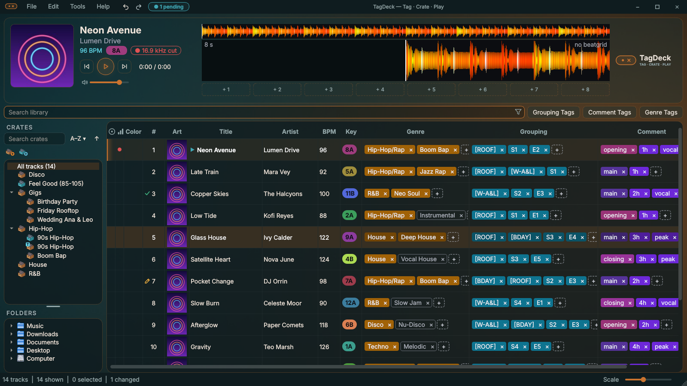
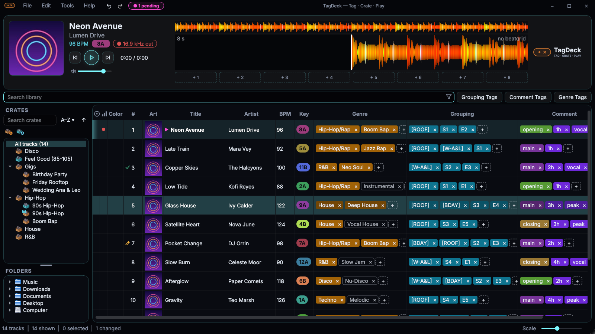
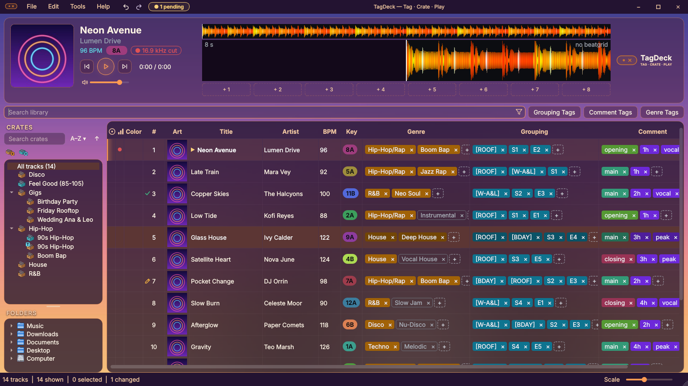
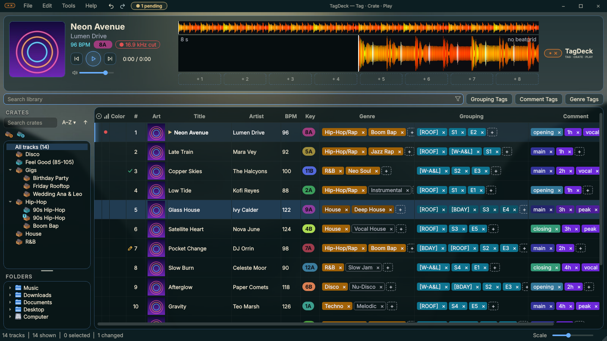

# TagDeck


**Chip Tagging and Crate Tools for Serato DJ** (Windows).

TagDeck reads your Serato library and crates. You can tag tracks fast with chips in Grouping and Comment, look up
missing info, check audio quality and manage crates. Every change waits for your review before anything is written.



> TagDeck is not affiliated with or endorsed by Serato. Serato and Serato DJ are trademarks of their owner.

## Features

- **Chip tagging**: Grouping and Comment (and optionally Genre, Label, Remixer) show as chips in the cell, with
  `+` and `×` buttons. You can also tag with hotkeys and with tag lists you define yourself. Chip actions:
  - Bring to Front
  - Replace across a selection
  - Remove a selection
- **Review before writing**: tag changes are collected first. *Tools › Review and Write* (Ctrl+S) shows every
  change and writes them to the files. Every write is logged and can be restored.
- **Player**:
  - High-resolution RGB waveform: overview plus a zoomed view with the beatgrid.
  - Cue buttons.
  - Autoplay of the next track.
- **Crates**:
  - Create, rename, move, duplicate and delete crates, with drag & drop of tracks and crates.
  - Smart crates with a live rules editor.
  - *Twin crates* (a normal crate kept in step with a smart crate, for rekordbox / USB exports).
  - Per-crate columns, plus the columns Serato itself shows for each crate.
  - A backup is taken before every crate change.
- **Status from Serato**: missing, corrupt, read-only and beatgrid-locked tracks, read from the Serato database.
- **Research**: looks up year, genre, label and cover art on MusicBrainz, Cover Art Archive, Discogs (with your own
  token) and iTunes Search. You choose what to keep.
- **Quality check**: finds low-quality or upscaled files from their frequency cutoff.
- **Folders**: browse your computer like Serato's *Files* panel.
- **Themes**: Amber (default), Neon, Vice, Mist and Classic.

| Neon | Vice | Mist |
|---|---|---|
|  |  |  |

## Safety

- TagDeck **never writes Serato files while Serato is running**. Close Serato before writing.
- Tags are written only from *Review and Write*. A write session can be undone from *Tools › Restore Write Session*.
- Crate files get a backup in `crate_backups/` before each change. Every crate change is one Ctrl+Z step.
- Musical key is never written. Fields with several values in one file are skipped.

Still, **back up your `_Serato_` folder before you start.** This is free software with no warranty.

## Install (Windows)

Download **TagDeck-Setup-<version>.exe** from [Releases](../../releases/latest) and run it. You need no Python
and no administrator rights. TagDeck is installed for your user, in `%LOCALAPPDATA%\Programs\TagDeck`, with a
Start menu entry and an optional desktop icon. To update, run the newer setup. Your settings, undo logs and backups
are kept.

The setup is not code-signed yet. On the first run, Windows may show *"Windows protected your PC"*: click
*More info › Run anyway*.

A **portable** zip is on the same page as well. Unzip it anywhere and run `TagDeck.exe`.

### Build it yourself

1. Install [Python 3.11 or newer](https://www.python.org/downloads/windows/). Tick *Add python.exe to PATH*.
2. Download this repository (*Code › Download ZIP*) and unzip it.
3. Double-click **`TagDeck_install.bat`**. It installs the Python packages and builds `TagDeck\TagDeck.exe` next to
   it.

### Run from source

```bat
py -m pip install -r requirements.txt
py TagDeck.py
```

Settings and the log (`tagdeck_debug.log`) are kept next to the script or the .exe.

## Discogs

Discogs lookups need a personal access token. Get one at
[discogs.com/settings/developers](https://www.discogs.com/settings/developers) and paste it in *Settings › General*
(or with the Discogs token button in the Research window). The token is stored only in your local settings.

## License

TagDeck is free software under the **GNU General Public License v3.0 or later**. See [LICENSE](LICENSE).

© 2026 Thanasis Karageorgos

Third-party components:

| Component | License |
|---|---|
| [PySide6 / Qt](https://doc.qt.io/qtforpython/) | LGPL-3.0 |
| [mutagen](https://github.com/quodlibet/mutagen) | GPL-2.0-or-later |
| [NumPy](https://numpy.org/) | BSD-3-Clause |
| [PyAV](https://github.com/PyAV-Org/PyAV) | BSD-3-Clause (bundles FFmpeg, LGPL) |
| [Inter](https://rsms.me/inter/), [Space Grotesk](https://github.com/floriankarsten/space-grotesk) fonts | SIL Open Font License 1.1 (see `fonts/`) |

Track metadata comes from MusicBrainz, Cover Art Archive, Discogs and iTunes Search. Use these services under their
own terms.
